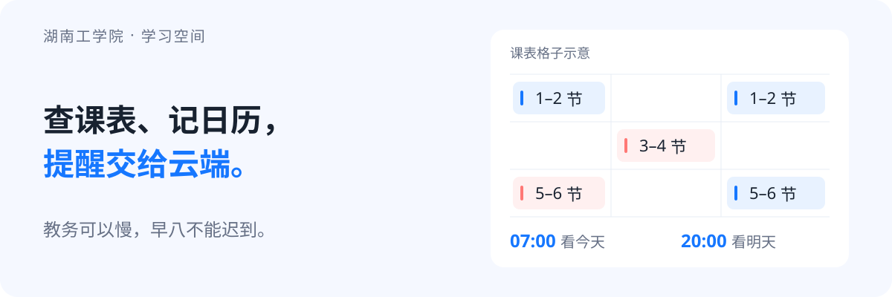
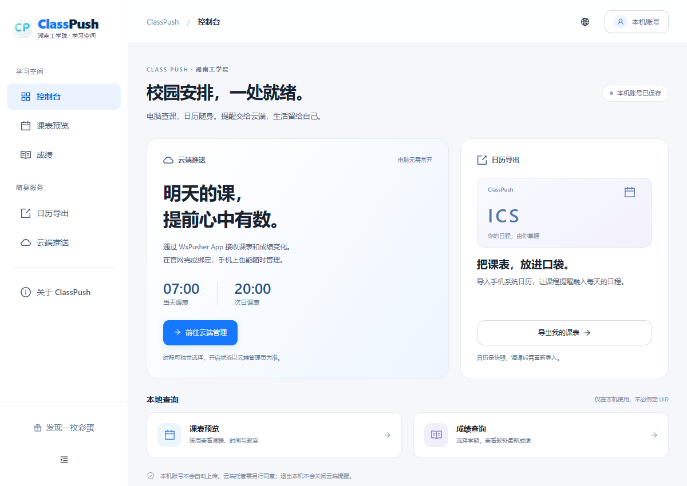
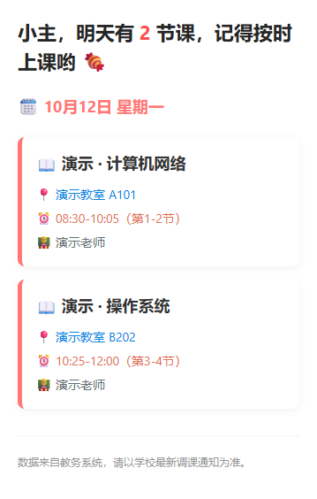
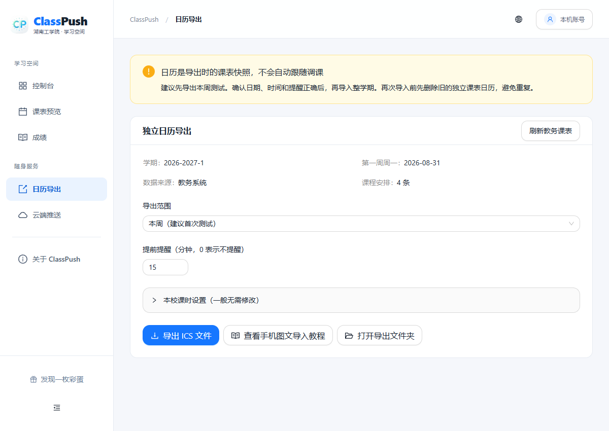

<h1 align="center">ClassPush 🎓</h1>

<p align="center">
  
</p>

<p align="center">查课表 · 看成绩 · 装进手机日历 · 提醒交给云端</p>

<p align="center">
  <a href="https://classpush.eliauk312.top/">官网</a> ·
  <a href="https://classpush.eliauk312.top/cloud.html">开启云端提醒</a> ·
  <a href="https://classpush.eliauk312.top/download.html">下载 Windows 版</a> ·
  <a href="https://classpush.eliauk312.top/calendar.html">日历导入图文教程</a>
</p>

<p align="center">湖南工学院限定 / v3.0.2 / Windows / MIT</p>

给本校同学做的一个课表与成绩小工具。不用反复翻教务，也不用为了收到通知把电脑一直开着。

**云端提醒现在直接在官网绑定，不需要自己部署 GitHub Actions。** 想用哪一部分就用哪一部分：桌面查询、日历导出和云端提醒互不强制绑定。

## 先看看长什么样



*桌面版的学习空间。截图使用合成数据，不包含真实账号。*

<details>
<summary>📬 手机收到的课表是什么样？</summary>

<p align="center">
  
</p>

保留熟悉的“小主”文案和彩色课程卡片。这是**实际云端模板生成的内容预览**，使用合成课程，非真实投递截图；WxPusher App 的外层界面由 App 决定。

</details>

## 这次，少折腾一点

- **云端不用自己部署了。** 官网绑定即可设置提醒，电脑关机也能收，不用 Fork 仓库、配 Secrets 或维护 GitHub Actions。
- **课表可以住进手机日历。** 支持本周、未来 7 天、全学期 ICS 导出，Android 和 iPhone 都配了[导入图文教程](https://classpush.eliauk312.top/calendar.html)。
- **成绩有变化才敲你。** 新出成绩或成绩修改时通知，首次只建立基线，不拿历史成绩刷屏。
- **桌面版换了个学习空间。** 查课表、看成绩、导日历继续保留；本地登录不需要推送 UID。

## 选一条适合你的路线

### ☁️ 想让手机按时提醒我

1. 安装 [WxPusher App](https://wxpusher.zjiecode.com/download/)，开启通知权限。
2. 进入[云端管理](https://classpush.eliauk312.top/cloud.html)，按 UID 帮助订阅本校应用，找到自己的 UID。
3. 填写教务学号、密码和 UID，阅读并同意托管说明，通过 App 验证码完成绑定。
4. 选择需要的提醒，取消勾选「暂停全部定时推送」，保存设置。

**通知在 WxPusher 独立 App 接收，不是微信消息。AppToken 不用填。** UID 是你自己的收件地址，别让它和发信的钥匙串岗。

| 提醒 | 北京时间 | 什么时候通知 |
| --- | --- | --- |
| 当天课表 | 07:00 | 选择开启后，按批次发送 |
| 次日课表 | 20:00 | 提前看看明天的安排 |
| 成绩变化 | 08:30、13:30、21:30 三批检查 | 有新增或变化才通知；首次只记录 |

按队列错峰处理，可能稍晚，不是卡着整点敲锣。新开启或恢复的提醒从下一批次生效，不补发过去的消息。云端使用本账号 **18 小时内的有效课表快照**，消息注明数据时间；没有有效数据就记录未发送，临时调课仍以学校通知为准。

想关闭提醒，回管理页暂停或删除云端资料。**关闭网页、退出管理、退出桌面账号都不等于暂停云端推送。**

### 📅 想把课程装进手机日历



下载桌面版 → 本校账号登录 → 打开「日历导出」→ 选范围和提前提醒 → 导出 ICS → 按[手机图文教程](https://classpush.eliauk312.top/calendar.html)导入。

建议先导本周试试，确认日期、时间和提醒没问题，再导全学期。最好新建一个独立的 ClassPush 日历，重新导入前清理旧课表，避免同一门课开起分身大会。

> 日历是导出时的快照，**不会自动跟着教务调课**。学校改课后需要重新导出；软件不会替学校瞎编开学日期。

### 💻 只想在电脑上查课表和成绩

到[下载中心](https://classpush.eliauk312.top/download.html)获取 Windows 安装包，按中文向导选择盘符、目录和桌面快捷方式，用本校学号和教务密码登录即可，**不用绑定云端**。

安装包和软件内更新都走项目自己的服务器。桌面版需要 WebView2，白屏等问题先看[使用帮助](https://classpush.eliauk312.top/faq.html)。

## 使用前说清楚

**目前只维护湖南工学院版。** 不是所有强智教务系统都能直接套用；学校修改接口、字段或登录流程时，也可能需要跟着修。

本地账号不会自动上传。只有你主动绑定云端并同意托管，教务凭据才会保存到服务器，个人凭据与缓存按账号隔离、加密保存。**运营者持有解密密钥，这不是端到端加密。** 是否托管由你决定，请先阅读[托管与隐私说明](https://classpush.eliauk312.top/privacy.html)。

<details>
<summary>从旧版升级：电脑定时任务与 GitHub Actions 怎么办？</summary>

新版不再使用本地定时推送或 GitHub Actions 推送。升级前先退出旧软件；新版会尝试停用能确认属于本校的旧 Windows 任务，保留任务记录。权限不足或无法确认时，需手动核对并停用，避免两边同时上班。自己部署过 GitHub Actions 的，也请停用旧工作流。

本机配置不会自动迁移成云端托管；需要你在官网主动绑定。升级后建议联网刷新一次课表与成绩。

</details>

<details>
<summary>没课表、没成绩通知，或者要重新登录？</summary>

- 学校尚未发布课表时，程序不能从空气里抓出来 qwq，等公布后再刷新。
- 成绩首次检查只建立基线，后续有变化才提醒；没有变化就不打扰。
- 教务密码变更、会话过期或认证流程调整，可能需要重新验证；不提供绕过认证的功能。
- 没收到通知，先看云端最近任务，再检查密码、本校应用订阅和 App 通知权限。
- 云端共用限速队列，错峰预取，遇到限流或连续故障暂停；不代表校方不会限制，也不承诺无限使用容量。

更多问题见 [FAQ](FAQ.md) 与[使用说明](TUTORIAL.md)。反馈时请带**脱敏日志**，不要把密码、验证码、Cookie 或 AppToken 一起打包送出来。

</details>

## 想改代码的话

<details>
<summary>项目结构、本地运行与部署文档</summary>

```text
RestoredSource/
├─ src/          本校教务客户端、桌面 API、日历导出
├─ frontend/     React + TypeScript + Ant Design
└─ tests/        桌面测试
cloud/           Flask API、账号存储与云端调度
website/         官网 HTML / CSS / JS
deploy/          部署与回滚
docs/            开发文档
```

建议 Python 3.12、Node.js 20+。Windows 桌面版源码运行：

```powershell
python -m venv .venv
.venv\Scripts\Activate.ps1
pip install -r RestoredSource/requirements.txt

cd RestoredSource/frontend
npm ci
npm run build
cd ../..
python RestoredSource/src/main.py
```

前后端联调可运行 `RestoredSource/run_dev.bat`。云端依赖、测试、部署见[部署说明](deploy/README.md)，教务限速与快照机制见[请求保护与调度](docs/教务请求保护与调度.md)。

自动化测试使用模拟数据。测试通过不等于真实手机收到消息——“在我电脑上是好的”不能直接当验收结论。

</details>

## 最后唠两句

如果它帮你少登了几次教务、少翻了几次课表，可以顺手点个 **Star ⭐**，给开发者一点继续修 bug 的动力。遇到问题欢迎提 Issue，也欢迎 Pull Request。

也欢迎来我的[博客](https://eliauk312.top/)串门，不查课表也能逛。

[MIT License](LICENSE) · 可以学习、修改和分享，记得保留作者与许可证信息。
